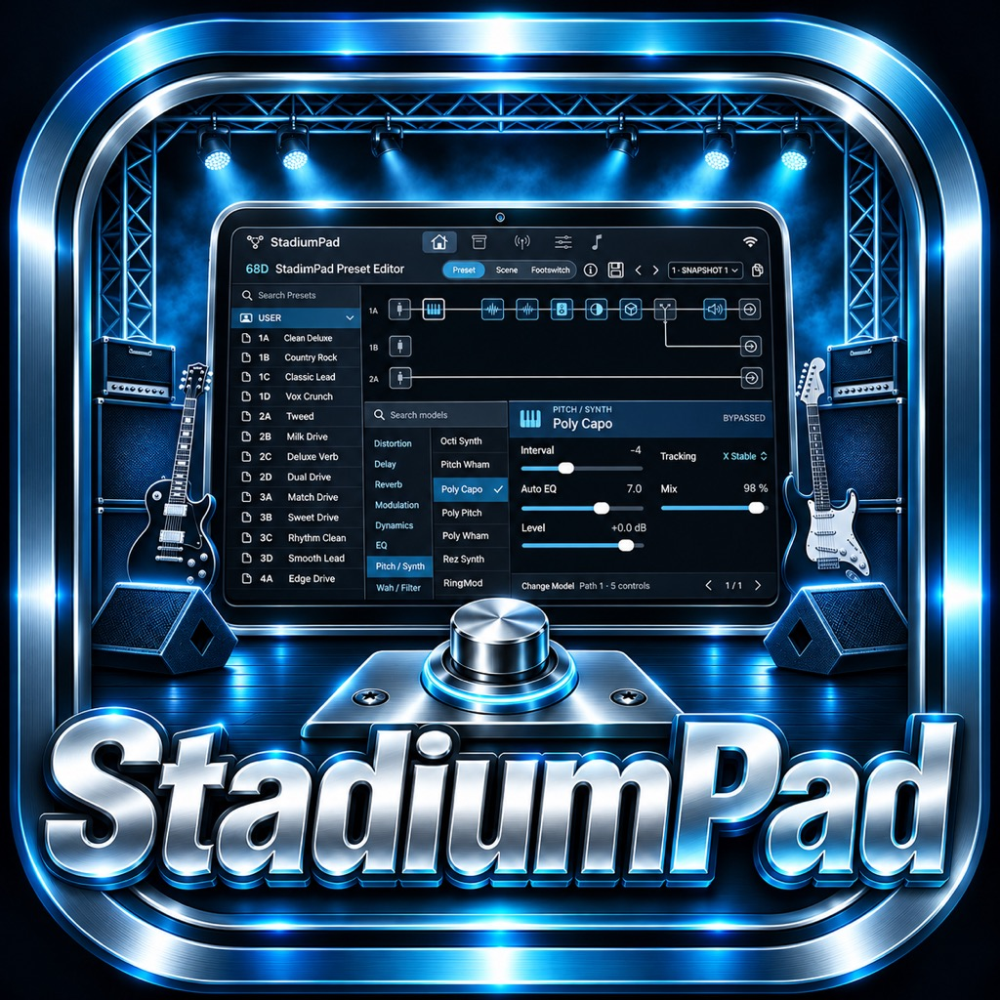

## Pi discovery — November 25, 2026

StadiumPad iOS 1.1.1 (51) and Android 1.2.1 (8) discover `_pedalbridge._tcp`
helpers from the connection screen. Pi advertisements can supply a dashboard
port; an explicit link opens its authenticated dashboard for the private pairing
link. Mac helpers are listed with instructions to copy their private link.
Discovery never pairs, changes a saved TLS pin/token or sends pedal commands.
Android cancels old resolver callbacks and timers when searches/routes change.

iOS device/simulator builds and 101 Swift regression tests pass. The regular-iPad
simulator screen was inspected: discovered Mac and dashboard-enabled helper entries
fit inside the connection popover. Android APK compilation/signing passes. Physical
Pi/client/AP/USB acceptance remains pending; existing hardware qualification limits
including USB EQ confirmation remain unchanged. No TestFlight upload in this task.

# StadiumPad

An unofficial, open-source **iPad/tablet editor for Line 6 Helix Stadium**.
Connect directly over your local Wi-Fi network or USB/Ethernet for editing and browsing. Clone
file transfers and library backups use the optional Mac companion. This is an early community proof of concept, not a complete replacement
for the official desktop editor.

<p align="center"></p>

## Android tablet update — 1.2.0 (code 7), November 24, 2026

Android now includes the current full-width Global EQ and Command Center screens,
pedal-style Matrix Mixer popup, centered core navigation with adjacent performance
icons, and automatic tuner entry/exit. Existing preset/folder browsing, scenes,
stomps, Focus, Hype, block movement and file companion remain available.
**PedalBridge support is retained**, including typed remote USB MIDI for Matrix.
Direct tablet USB MIDI is also available with explicit device identity confirmation.
Wi-Fi-only connections cannot send Matrix controls.

The physical TCL 12-inch tablet connects through the Mac helper. Bounded live
Phones/Home pan, mute and Solo on/off checks passed and were restored. EQ controls
and native transaction logic are implemented, but **EQ persistence confirmation on
the helper's USB editor route remains unqualified**: ACKs are received while the
native settings snapshot stays unchanged. Command Center assignment, parameters, scene flags, copy/paste and appearance
checks passed on a new spare, whose original bytes were restored. Pre-existing saved
User presets were independently checked unchanged. EQ test settings were restored; do not
interpret optimistic graph movement as proof. Matrix fader calibration, every
source/output combination and physical direct-USB Android operation are not fully
qualified. This development update is not a TestFlight submission or a claim of
complete desktop parity. See [validation](docs/VALIDATION.md).

## Historical PedalBridge milestone — 1.1.0 (50)

Connection choices now include **PedalBridge** on iPad and Android, alongside
existing direct connections. Pair with the separately running Mac helper using
its private QR/link. The tablet can stay on Wi-Fi or its charger while Stadium
connects to the helper by USB. The iPad Matrix popup uses guarded remote USB MIDI
and retains the native transaction/readback flow. If Stadium is Wi-Fi-only at the
helper, Matrix control is unavailable. Only one tablet owns a bridge editor lease
at a time; disconnect it before changing tablets. Pairing is stored in iOS Keychain
or Android app-only Keystore encryption, with pinned TLS on every helper socket.

The signed Mac helper and physical Pro read-only session are checked; Android's
native client is checked in an isolated tablet emulator against the real Stadium.
Actual bridged Matrix write/restoration and physical Android tablets remain
unqualified. Android retains its existing feature coverage; its full iPad Matrix,
Global EQ and Command Center presentation is not added in this milestone. The
existing clone-file companion is separate. Raspberry Pi/AP is planned for hardware
qualification. This build has **not** been submitted to TestFlight in this change;
the previously verified approved build below remains a separate release.

## Version 1.0 beta candidate

Version 1.0.0 (49) has a centered **Matrix Mixer** button opening a pedal-style
mixer popup. The popup uses output icons for ¼-inch, XLR and Phones and remembers
the last viewed output. Generic Song tracks 1–5 use the standard Drums, Bass,
Guitar, Vocals and Other stem labels; specific native names take precedence. Home and Song expand into a horizontally scrollable row;
sideways swipes over the faders scroll without changing their values. Opening is local. With direct USB, Close also sends a guarded pedal-mixer close
sequence. Tapping an output
icon inside the popup selects that output’s mixer on the pedal. Repeated taps use
a confirmed different-output step to avoid closing the pedal’s selected mixer. This beta is **not a fully qualified USB build**. USB reads/Save Copy and bounded Phones/Home
Solo/pan checks pass. USB Global EQ confirmation and remaining mixer coverage still
need qualification.
See [USB/Matrix development status](docs/USB_MATRIX.md). App Store Connect verified on November 23, 2026: **1.0.0 (49) is Approved** and assigned to StadiumPad Public Beta. Existing owner installer mirrors remain unchanged.

## What it does

- **Persistent top navigation (iPad):** Home, Librarian, Command Center, Global EQ
  and Songs stay centered. Preset, Scene, Footswitch and Tuner use matching labeled
  icons directly to the right of Songs, separated by a divider, and return directly to that
  view from any page. Matrix Mixer sits directly left of Home. Footswitch uses an original side-view
  foot pressing a pedal icon. Tuner activates on entry; Turn Tuner Off returns to the Home editor.
  Every main section, mode and Matrix button exits tuning on the pedal.

- **Preset view:** scrolling User/Factory preset browser, expandable setlist folders,
  signal chain, named parameter controls, category/model lists, exact selected-model
  highlighting and automatic scrolling. Drag effects to rearrange occupied or empty
  positions within the same signal row. Includes Looper, FX Loop and Utility models.
- **Pinned Hype knob:** available beside the selected amp/model name whenever
  that model exposes Hype. It stays visible on every parameter page, with its
  native value readout; drag to adjust or use VoiceOver's adjustable action.
- **Focus View:** tap the aperture beside the model name. Factory named tones and
  X/Y blending for mapped models, precise X/Y controls, Restore starting tone,
  cabinet mic placement, and editable EQ band gain/frequency controls. It occupies
  the signal-chain area while presets and normal controls remain visible. Opening
  the view preserves the tone; adjustments are live and remain unsaved until Save.
- **Scene view:** eight large colored scene buttons using the preset's snapshot names.
  Select an existing scene or confirm copying the current scene into an empty slot.
- **Footswitch view:** virtual Stomp A/B pedalboards using actual controller assignments,
  including grouped effects and inverse ranges. Unsupported timed, momentary and
  command/MIDI switches are visibly unavailable rather than partially executed.
- **Tuner mode:** requests the Stadium tuner on entry and sends its exit command when
  leaving. Known network messages do **not** expose live note/cents readings; read
  those on the Stadium display. Command acknowledgements are not pitch measurements.
- The preset browser stays on the left in every Home mode. Scene/stomp boards fit regular
  iPad and 12.9-inch Pro layouts without workspace scrolling; preset/model lists scroll.
- Guarded parameter/model/output changes, User Save and verified Save Copy into an
  empty slot. Backups retain native saved/live bytes before editing.
- Two-way block selection: selecting on the pedal updates the chain, model browser
  and controls; tapping a block on the tablet selects it on the Stadium too.
  External model replacements also bring their block into view. The Follow option
  controls incoming selection; parameter/model edits continue to update both devices.
  Each tablet remembers the last selected block per device and preset. On startup
  it reads the pedal's active preset and restores that preset's local view, without
  recalling a preset or moving the pedal's selection. Missing history/removed blocks
  fall back to a valid block; new live events take priority. This is remembered view
  state, not a query of changes made on the pedal while the app was closed.
- Bonjour device search, selection and manual address entry, including switching to
  another Stadium. The app uses your device, not a developer-specific address.
- **iPad Global EQ:** full-width desktop-style graph with seven draggable colored
  bands, independent 1/4-inch/XLR/Phones EQs, band enable, frequency, gain, Q,
  6/12/18/24 dB/octave cuts, output level and bypass. Includes Copy/Paste between
  outputs, Reset, sliders, value entry and live desktop/pedal broadcasts. Settings
  apply immediately, separately from preset Save; the preset sidebar is hidden.
  The graph is a calculated preview, not an audio measurement.
- **iPad Command Center:** full-width controller map and desktop-style assignment
  inspector, with the Home preset sidebar hidden. Select Stomp A/B, 16 Instants,
  X/Y, onboard EXP1/EXP2/toe, or configured external controls. Edit Command1/2,
  Preset/Snapshot, Song, Looper, Utility, ExtAmp, MIDI and HotKey assignments using
  named choices, value sliders and numeric entry. Includes snapshot-controlled
  parameters, Copy/Paste, Copy All/Paste All, Clear/Reset All, custom stomp labels
  and LED colors. Changes remain unsaved until Save Preset. External controls are
  disabled when their jack is configured for another input type.
  This assignment editor does not extend Gig View to execute MIDI/HotKey commands;
  those commands run from the Stadium's configured physical controls.
- **Librarian layout:** a full-width workspace with Presets, Cab IRs, Favorites,
  Templates, Songs and Clones categories. Presets has separate setlist and preset
  panes, folder selection and search. The Home preset sidebar and scene/save bar
  are hidden here. Clones has category folders, nested folder navigation and search.
- **Clone files:** pair with StadiumPad Companion on your Mac to import `.clone`
  files, export originals, and create/rename/delete compatible User clone folders
  and entries. Imports preserve file bytes and refuse duplicate identities, including
  files present on the pedal but absent from its visible index. Uncertain writes
  are never automatically retried. Factory/protected content is excluded.
- **Download Library:** copy User Clones and User IR WAVs into a durable ZIP on the
  tablet, with folder metadata and per-file SHA-256 checksums. Open/share the latest
  backup from Librarian. Originals remain on Stadium; this is file storage, not
  tablet DSP or offline preset editing. Current backup limit: 256 MB.
  [Mac companion setup and limits](Companion/README.md).
- Read library inventories: Factory/User presets, setlists, IRs, Favorites, Templates,
  Songs and the clone hierarchy reported by the device. File-based models need files.

**Global EQ validation:** checked on an iPad Pro with Stadium: graph dragging is
responsive, the pedal follows, and no confirmation warnings appear. Native streaming,
commit/readback and restoration checks also preserve the current preset. Audio
measurements and persistence through a pedal power cycle remain unqualified.

## What is not implemented yet

Android Command Center and Global EQ editing, song/Showcase editing and
transport, IR file import/assignment and clone-to-block assignment, preset renaming after creation,
block insertion/removal, cross-row/path moves, general routing editing, snapshot renaming,
firmware updates and PIN authentication. Desktop Focus user-default management,
favorites creation and vendor equipment artwork are not implemented. Songs navigation remains a labeled unfinished section. Output destination selection is a narrower supported
operation, not a complete routing editor. Dragging leaves input/output and split/merge
nodes fixed; branch layouts that cannot be established safely are refused. Amp replacement refuses when Auto Cab
would add unexpected blocks; disable Auto Cab on the device first if appropriate.

**Offline preset editing/creation and reconnect synchronization are planned, not
shipped.** A native Android tablet port now accompanies the Swift/iPad source; see
[Android build and validation](Android/README.md). There is no phone UI. A phone version would require a
substantial interface redesign.

## Install

For nontechnical users, **1.0.0 (build 49) is Approved** in TestFlight and assigned to StadiumPad Public Beta, verified November 23, 2026. [Installation instructions](INSTALL.md) explain the TestFlight installation
route and the source-build route currently available to developers. Android uses
a signed APK installed through Android Files; there is no Google Play listing.

## Connect and use

Build and sign with your own Apple developer identity, install on an iPad running
iPadOS 18 or later, allow Local Network access, and put it on the same LAN as the
Stadium with Remote Access enabled. Tap **Connect → Search Network**, select your
Stadium, or enter its hostname/IP. The connection panel remains available for
switching devices. No credentials, analytics service or cloud account are embedded.
Existing Remote Access restrictions are not bypassed.

Changes reach the pedal immediately. Use **Save** to retain them; Factory presets
require **Save Copy**. Selecting another preset discards unsaved edits, as in the desktop workflow;
the saved source is unchanged and its saved/live bytes are backed up locally first. Snapshot
switching follows the device's Snapshot Edits behavior. Documents/"Preset Backups"
contains local backups and can contain personal preset data; keep it out of Git.
Network failure can leave a write uncertain: check the pedal before retrying.
Tuner exit cannot be guaranteed after network loss or process termination.

## Build

Requires macOS, Xcode with iOS 18+ SDK, Swift and Python 3. No third-party Swift
runtime dependencies. Choose build/cache directories appropriate to your machine;
do not put generated outputs in the repository.

```sh
swift test
python3 -m venv /path/to/dev-venv
/path/to/dev-venv/bin/pip install -r requirements-dev.txt
/path/to/dev-venv/bin/python -m unittest discover -s Tests -p '*integration*.py'
```

For an external Swift build directory, use `swift test --scratch-path /path/to/build`
and set `STADIUM_PROBE`, `STADIUM_EDIT_CHECK`, `STADIUM_LIBRARY` to its `debug/` executables and
`STADIUM_TEST_ROOT` to a scratch directory before running Python tests.

### Matrix touch regression tests

The optional native UI suite uses synthetic local controls and cannot connect to
Stadium or send MIDI. It expands Home/Song, swipes across faders to both ends,
checks that horizontal swipes leave values unchanged, and verifies vertical dragging.

```sh
STADIUMPAD_UI_TESTS=1 STADIUMPAD_DEVELOPMENT_TEAM=YOUR_TEAM_ID \
STADIUMPAD_BUNDLE_ID=your.unique.stadiumpad python3 Scripts/generate_project.py
xcodebuild -project StadiumPad.xcodeproj -scheme StadiumPadScrolling \
  -destination 'platform=iOS,id=YOUR_DEVICE_ID' \
  -derivedDataPath /path/to/external/build test
```

An iPad simulator destination also works. Physical-device tests require the device
to allow UI automation. The harness is compiled only into Debug and selected only
by its explicit test launch argument; it is absent from Release.

### Local model metadata

Extracted Line 6 metadata/artwork/binaries are **not** included in this repository.
For named model browsing, Focus and editing, prepare functional metadata locally from
an installed editor you are entitled to use. The reference tools are
[Vheissu/helix-stadium-tools](https://github.com/Vheissu/helix-stadium-tools), tested
at `dad97d3a2011290f7f6630d04cc1a819cc58752b`. Its
`scripts/generate_mobile_block_types_json.py --output /private/path/blocks.json`
and `scripts/generate_io_models_json.py --output /private/path/io.json` read local
editor resources; consult that project's extraction requirements/options.

```sh
python3 Scripts/prepare_parameter_catalog.py \
  --blocks /private/path/blocks.json --io /private/path/io.json \
  --controls '/Applications/Line6/Helix Stadium.app/Contents/Resources/P35Controls.json' \
  --uidefs '/Applications/Line6/Helix Stadium.app/Contents/Resources/P35ModelUIDefs.json'
```

This creates ignored `iPad/Resources/ParameterCatalog.json`. Generic labels are
used without metadata; guessed parameter controls/model replacements are not
exposed. Do not commit extracted catalogues or vendor help/artwork.

```sh
STADIUMPAD_DEVELOPMENT_TEAM=YOUR_TEAM_ID \
STADIUMPAD_BUNDLE_ID=your.unique.stadiumpad \
python3 Scripts/generate_project.py
xcodebuild -project StadiumPad.xcodeproj -scheme StadiumPad \
  -configuration Release -destination 'generic/platform=iOS' \
  -derivedDataPath /path/to/ipad-build -allowProvisioningUpdates build
```

The generated project is ignored because it contains your local signing settings.
Use your own signing/profile; no team identity or provisioning profile is published.
This is source distribution, not an App Store release or universally installable IPA.

## Contribute

Report reproducible bugs, suggest improvements or submit a PR. Include firmware,
app version, expected/actual behavior and steps to reproduce; remove private preset
and device data. Please read [CONTRIBUTING](CONTRIBUTING.md),
[SECURITY](SECURITY.md), [AI/LLM handoff](README_AI.md) and
[verification status](docs/VALIDATION.md). Public visibility permits forks and PRs,
not direct write access to this repository. Maintainers decide what merges.

MIT licensed. [Acknowledgments](ACKNOWLEDGMENTS.md) credit Dwayne Charrington's
research and implementation, Line 6's work, and the Quad Cortex/Tone Master Pro
workflow inspiration. This project is not affiliated with those manufacturers.
We hope an official Line 6 iPad editor makes StadiumPad unnecessary one day;
that hope is not a statement about their roadmap.

### Local Focus metadata

After preparing ParameterCatalog.json, generate the reference `focusModels.json`
locally using helix-stadium-tools' `scripts/generate_mobile_focus_data.py` and the
extracted factory Focus definitions. Then run:

```sh
python3 Scripts/prepare_focus_catalog.py --source /path/to/focusModels.json \
  --modeldefs /path/to/installed-editor/modeldefs/p35md-1_4_0_0.bin
```

This validates complete maps against native ids/types/ranges and adds Focus-only
controls that the normal editor layout omits. Both generated catalogues stay out
of Git. A missing/incompatible map remains unavailable; no invented tone map is
substituted. EQ displays control positions, not a live spectrum or a measured DSP
response. Cabinet coordinates use native Position/Distance with quarter-inch
Distance steps. Equipment backgrounds are original vector/SF-symbol treatments.


## Matrix USB entry guard — November 26, 2026

The top Matrix Mixer icon is gray when the current connection has no usable USB
Matrix transport. Tapping it explains: “Stadium must be connected via USB to either
PedalBridge or your tablet to use Matrix Mixer.” It does not open the popup, exit
tuner mode or send pedal commands. Direct tablet USB still requires the existing
identity confirmation before controls can write; bridged access uses the helper's
verified Matrix capability. A connection/USB loss dismisses the iPad sheet.

iPad 1.1.1 (52) builds and is installed on the owner's Pro. The unavailable-entry
UI test passed; simulator layouts inspected. 102 Swift tests pass. Android1.2.2
(code9) builds/signs, passes809 schema/routing checks plus8 loopback transaction
tests, and its gray navigation was inspected on the emulator. The physical Android
tablet was not available for this install. No live Matrix write test or TestFlight
upload was performed. Physical iPad read-only diagnostics confirm a PedalBridge
Wi-Fi connection,20 blocks and incoming events after the helper recovery.


## iPad folder memory and foreground reconnect — November 26, 2026

Build1.1.1(53) remembers the last opened user folder separately for each Stadium.
When folder inventory arrives, it expands that folder and collapses the others,
including All User Presets. Without a valid saved folder it uses the folder
containing the active preset, then All User Presets. Duplicate membership retains
the preferred folder. Folder expansion and successful row selection save the
preference; search can temporarily reveal matches without erasing it. No folder,
preset or pedal setting is changed by this preference.

Brief inactive states no longer close the editor. Backgrounding releases the
connection; returning resumes only a previously active PedalBridge connection,
with a fresh lease/snapshot after prior disconnect completes. Explicit disconnects
remain disconnected. Interrupted edits are never replayed.

105 Swift regression tests pass. A synthetic iPad UI test verifies delayed folder
loading, single-folder expansion and remembered restoration across termination/
relaunch. Device build/install pass. A bounded physical Pro check called the
background/resume handlers: connected before/after, connection identity changed,
preset unchanged. It does not simulate every iPadOS suspension condition. No
preset write test or TestFlight upload. The reported preset-switch latency has
not been independently timed on a live switch; required backup/readback remains.


## PedalBridge read latency — iPad build54, November26,2026

Bridge connections group independent state reads inside the existing FIFO
transaction. Snapshot phases remain before-ID/snapshot → native edit bytes,
reference and dirty flag → after-ID/snapshot. Every reply must match its own
request ID and typed response address. Preset/snapshot changes still reject the
read, native bytes remain unmodified, and edits are never batched or retried.
Identity confirmation also groups its two read-only checks. Direct tablet
connections keep their existing read path. No mode or preference was added.

A physical Pro read-only comparison on the same unedited preset measured about
900ms before transport tuning,707ms after the Pi TCP acknowledgment hint, then
663ms sequential versus554ms grouped in a paired check. Both guarded reads returned
the same raw edit bytes, preset ID, snapshot and dirty flag. These measure state
reads, not a complete preset/model/move write. Real action latency still needs
user confirmation; saved/live backups and post-edit verification remain intact.

105 Swift tests and3 additional loopback cases pass (reversed replies with stale
IDs, preset changes, missing replies). iOS build54 installs on the Pro. The timing
harness is DEBUG-only and stores durations without native preset contents. Android
has not yet received the grouped client-read optimization; the Pi transport hint
benefits either client. No TestFlight upload or live preset edits during testing.


## Physical Pi USB check and optimized iPad build55 — November26,2026

Build1.1.1(55) is installed as an optimized device build of the same source. For
performance qualification, use Release or pass `SWIFT_OPTIMIZATION_LEVEL=-O` to
xcodebuild Debug (which retains the explicit read-only DEBUG timing harness).
The ordinary generated Debug configuration remains suitable for debugging.
105 Swift tests pass in Release. No UI/protocol change or TestFlight upload.

The Pi reports a verified USB editor route and matching MIDI Matrix availability.
An initial helper MIDI resource leak/fallback was corrected in PedalBridge; see
its live-Pi validation. Current iPad state reads over USB still average roughly
0.6–0.7sec. The optimized build has not demonstrated an action-latency improvement;
full preset/model/reorder response remains pending owner feedback. No live preset,
parameter, mixer or save write was performed during this qualification.
